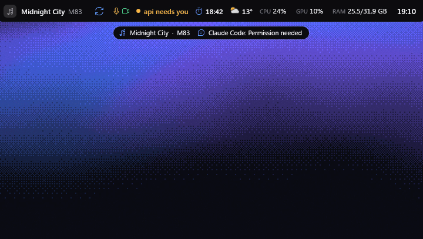
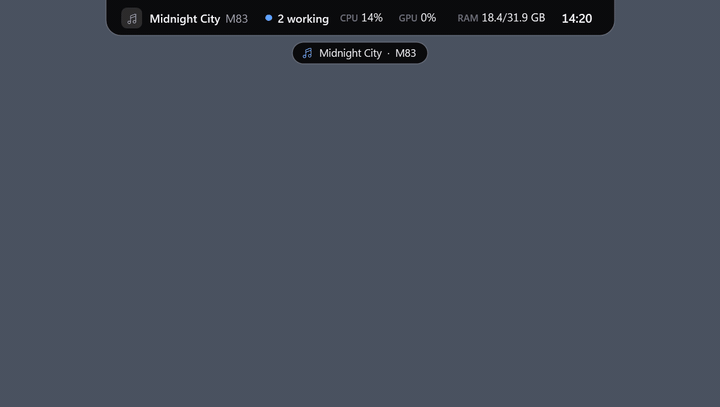
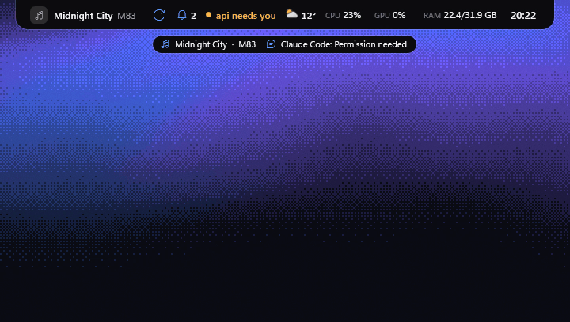
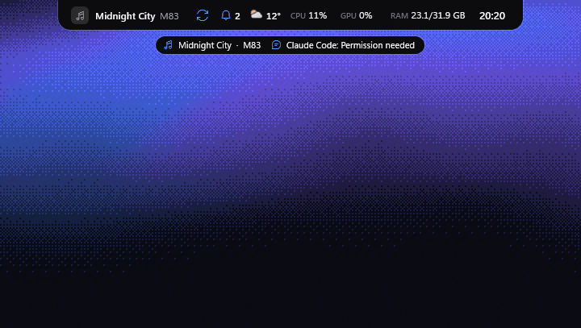
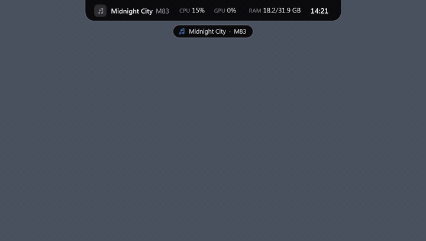
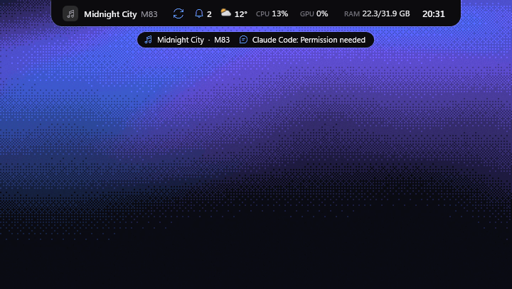
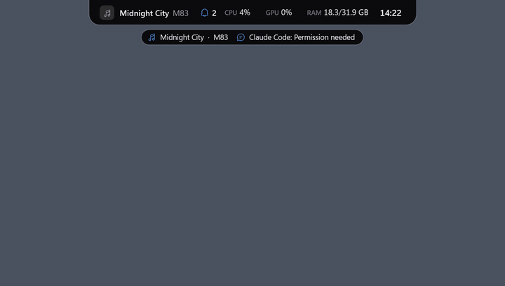
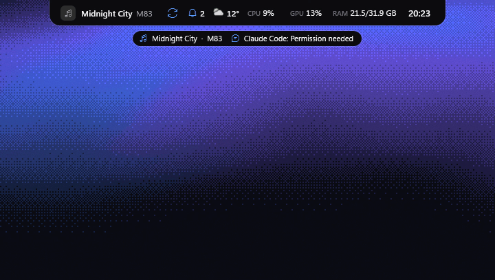
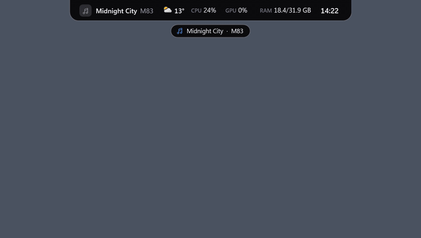

# QNotch

**A free, open source Dynamic Island-style notch for Windows and Mac.** Your music, system stats, clipboard, files, and coding agents, one hover away.

**[Download for Windows](https://github.com/Somafet/qnotch/releases/latest/download/QNotch-self-contained.zip)** · **[Download for Mac](https://qnot.ch/mac/)** · [Try the live demo](https://qnot.ch)

Free and MIT licensed. No account required. On Windows it idles at about 0.08% of one core and 42 MB of memory ([measurements](docs/windows/README.md#performance)).

Recorded from the Windows app with demo data.

## Know when an agent needs you

Running several Claude Code or Codex sessions? QNotch shows each one by title and status. When one needs you or finishes, the notch tells you and plays a sound. One click takes you back to that session.

It also lists the dev servers and test runners your agents started, including any left running after a session ended, each with a Stop button.

## Get notified by your scripts

Post to the notch from the command line or local HTTP, add buttons, and wait for the answer. [Notification reference](docs/notifications.md).

## Watch your AI limits

See Claude Code and Codex usage before you hit a limit, and open your AI apps with a hotkey.

## Never lose what you copied

Clipboard history keeps text, code, links, and images, with pins for what matters. It stays in memory unless you choose to save it.

## Drop files on the notch

Drag files onto the notch and choose where they go: the tray, or another device with Taildrop. On Windows, connect your phone to the same Wi-Fi and scan a QR code to move files in its browser, with no app.

## Find anything

One search box covers clipboard history, files, notes, notifications, tasks, tabs, and settings.

## Control your music

See the track and control playback without switching apps. Works with apps that appear in the Windows media controls, and with Music and Spotify on Mac.

## Make it yours

Drag cards and tabs into your order, and turn off what you don't use. A disabled feature is never loaded. Cards include system stats, weather, notes, volume, a timer, a color picker, GitHub contributions, and scheduled tasks.

## Stay out of the way in games

When a game is in front, the notch steps aside and keeps only a slim status display.

Press Ctrl+Alt+N to toggle the panel and Ctrl+Alt+F to search. On a Mac, that's Control+Option+N and Control+Option+F. Features differ by platform: see the [Windows guide](docs/windows/README.md) and the [Mac parity table](docs/macos/parity.md).

**[Download for Windows](https://github.com/Somafet/qnotch/releases/latest/download/QNotch-self-contained.zip)** · **[Download for Mac](https://qnot.ch/mac/)**

## Install

### Windows

Windows 10 version 2004 or newer, x64.

- **Free download:** [`QNotch-self-contained.zip`](https://github.com/Somafet/qnotch/releases/latest/download/QNotch-self-contained.zip) runs without installing anything. [`QNotch.exe`](https://github.com/Somafet/qnotch/releases/latest/download/QNotch.exe) is smaller and needs the [.NET 10 Desktop Runtime](https://dotnet.microsoft.com/download/dotnet/10.0).
- **Scoop:** `scoop bucket add qnotch https://github.com/Somafet/scoop-bucket`, then `scoop install qnotch/qnotch`.
- **[Microsoft Store](https://apps.microsoft.com/detail/9MTFK5R4799F):** an optional, paid way to support development. It's the same app, installs without a SmartScreen warning, and updates through the Store.

The free downloads are not code-signed yet, so Windows may say "Windows protected your PC" on first run. Click **More info**, then **Run anyway**. [First-run and update details](docs/windows/README.md#install).

### Mac

Apple silicon (M1 or newer), macOS 13 or newer. There is no Intel build.

[Download the disk image](https://qnot.ch/mac/). It is signed with a Developer ID, notarized by Apple, and has built-in updates. [Mac guide](docs/macos/README.md).

## Privacy

Settings, notes, and logs stay on your computer, and secrets go in Windows Credential Manager or the macOS Keychain. Clipboard history stays in memory unless you choose to save it. Optional integrations and update checks make network requests.

Both apps send usage events (which features you use, never your content) unless you turn off Share usage data in Settings, General. Read the [privacy policy](https://qnot.ch/privacy) or the data details for [Windows](docs/windows/README.md#privacy-and-data) and [Mac](docs/macos/README.md#data-permissions-and-diagnostics).

## Contributing

If QNotch is useful to you, a star helps other people find it. Bug reports and ideas are welcome in [issues](https://github.com/Somafet/qnotch/issues).

To work on the code, start with [CONTRIBUTING.md](CONTRIBUTING.md), then pick an area:

- [Windows](docs/windows/development.md): C#/.NET 10 and WPF.
- [macOS](docs/macos/README.md): native Swift and AppKit.
- [Website](website/README.md): Astro.
- [Repository tooling and CI](docs/releases.md#required-checks): Node.js 24+, `npm ci`, then `npm test`.

[ARCHITECTURE.md](ARCHITECTURE.md) covers shared principles and the Windows implementation, [spec/README.md](spec/README.md) holds common behavior, and the [documentation index](docs/README.md) lists the rest.

## License

[MIT](LICENSE)
