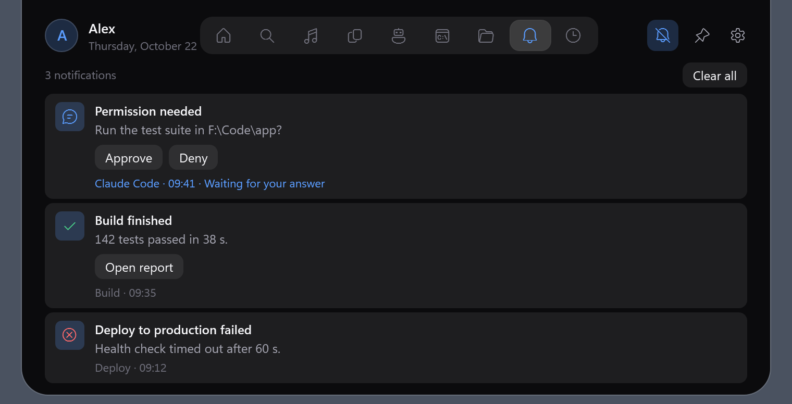
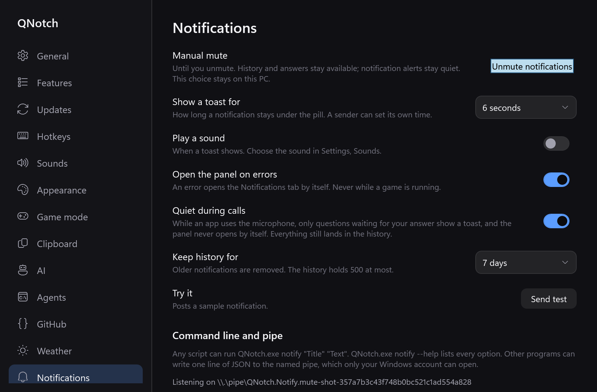

# Windows notification mute evidence

Windows portion of #77, stacked on the independent presentation change. Mac PR #83 was refreshed and reviewed before editing; it uses indefinite mute with local state. No overlapping Windows mute implementation existed in open or merged PRs. No shared portable field was added.

Mute persists until cleared in `notifications.local.json`. The accessible panel header toggle, checked tray action and Notifications settings reflect the same state. It clears the current toast and timer and suppresses both ordinary and pending/waiting toasts, sounds and automatic error opening. Incoming notifications retain normal history/unread behavior and all waiter/action transport semantics. Suppressed pending alerts remain answerable in history and do not reappear when unmuted. Per-app mute and the quiet-call waiting exception remain intact. Timer, Agents and updater alerts are independent. Optional timed expiry is omitted, so there is no expiry timer or polling.

Shared shell additions are a generic quick-action registry, a panel-header host, and tray-menu factory hosting. Notification state and behavior stay in the module. No shell file names Notifications. Whole-module enablement still applies on restart.

Validation on Windows x64, Windows 11 Pro 25H2, .NET 10 Release, Ryzen 9 5900X / 24 logical processors / 32 GiB:

- Release build with warnings as errors and win-x64 publish passed.
- Updater 27/27, phone sharing 10/10, onboarding 25/25 and all four focused Windows checks passed. One initial test build collided with an owned diagnostic executable lock; the final sequential build/check/publish run passed.
- [Native smoke](smoke.txt) ended in `done`; snapshot checker passed. The new `notify-manual-mute` check covers accessible toggle activation, existing toast cancellation, pending requests, unread error/history, no replay, answer/dismiss results and quiet-call exceptions. Real `notify --wait` while muted returned `approve` with no toast; real pipe notify/dismiss, timeout and sender-disconnect paths passed.
- Muted deterministic snapshots with explicit isolated data ended in `done`, passed the checker, and were inspected (images above). No user's instance was driven. Native top attachment, Game mode, presentation and accessibility checks passed. Synthetic foreground-taking checks report Windows refusal as skips.
- New mute storage defaults off and round-trips locally; setup-code exclusion regression passed. No app runtime dependency, Mac, packaging, release or update-endpoint change.

The [live muted measurement](performance.json) used only Notifications, its real pipe, HTTP/microphone watcher off, collapsed panel, 15 s warmup and a 30.004 s interval. It measured 0.380% of one core and 1.1 to 10.1 MB resident. [PID-filtered WPF ETW](render-summary.json) validated the provider with startup renders and found one render during the interval. Thus memory passes; the CPU and zero-repaint targets are **not** established. The unmodified full-app baseline also exceeded CPU (0.315%); these measurements are reported as failures, not performance approval. Raw system-wide ETL/XML is local only; public evidence contains this process's counts.

Remaining manual checks: physical global hotkey focus/foreground acquisition, tray-menu interaction on the desktop, external mixed-DPI/negative-origin displays, physical nudge/reconnect, and a quiet environment satisfying the idle targets. No merge or release requested.
