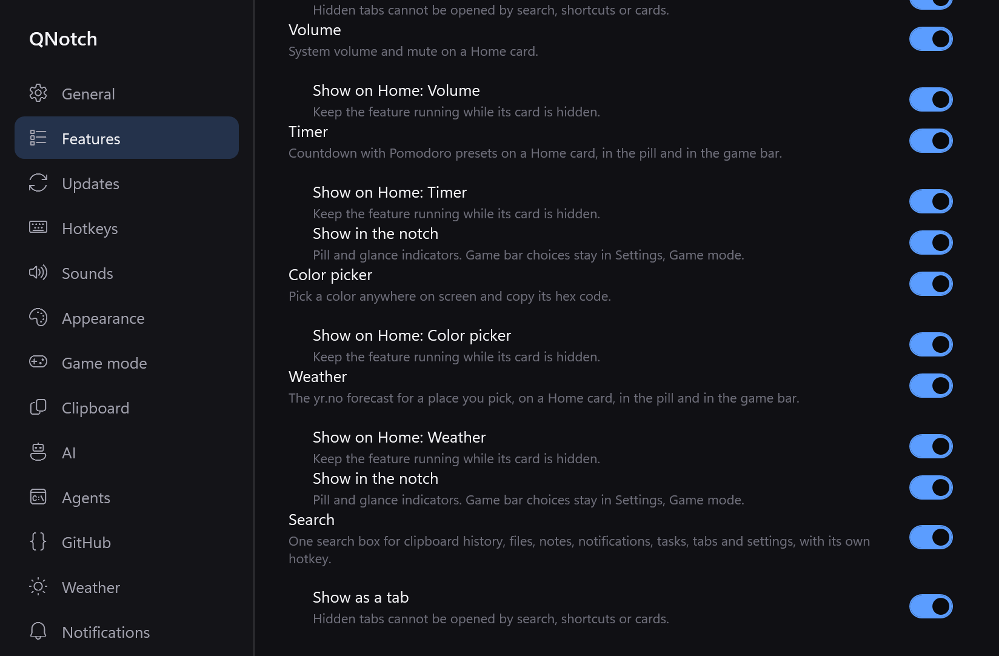

# Windows presentation evidence

Issue #78, Windows x64, based on `7f1088e`. Registry ownership is recorded during module initialization; controls enumerate real contributions. Timer has no tab, Agents has no card, AI has two cards. Home and game-bar storage are reused. New tab/notch fields live only in `windows-presentation.json`; Weather keeps `ShowInPill`. No portable setup fields changed.

Validation on Windows 11 Pro 25H2, AMD Ryzen 9 5900X, 24 logical processors, 32 GiB RAM, .NET 10 Release:

- Warning-free Release build and win-x64 publish passed.
- Updater 27/27, phone sharing 10/10, onboarding 25/25 passed.
- Windows behavior regressions passed: JSON round trip and unknown ids, hidden/disabled card ordering, welcome-tour Search choice.
- Native smoke passed, final `done` in [smoke.txt](smoke.txt); snapshot checker passed. Inspected Features top/end PNGs. The `presentation` check covers every registered tab, selected/last-selected fallback, direct/keyboard/search blocking, Search shortcut release/restoration, empty Home recovery and retained module identities. Windows denied foreground acquisition for the synthetic hotkey checks; these explicitly report skips, while the internal Search field focus check passed.
- Separate isolated debug lifecycle: Features Search off, quit/boot, Search not constructed, tab/open/hotkey rejected; Features on, quit/boot, Search restored with saved `Ctrl+Alt+Shift+F`. First-run welcome switch has deterministic coverage; the on-demand tour remains read-only by contract. No Windows #76 failure reproduced, so its restart lifecycle is unchanged.
- Native placement check passed: full monitor top attachment. Existing nudge and Game mode geometry code is unchanged; game-mode and corner snapshots passed. Negative-origin external displays, mixed DPI, physical nudge/reconnect and physical global chords still require hardware/manual checks. #74's menu-bar geometry is Mac-only (current Mac PR #82).
- `npm ci`, all 42 repository checks and `git diff --check` passed. CI retains the required `build` aggregate and now runs Windows behavior checks.

The [baseline measurement](baseline-performance.json) exceeded the CPU target (0.315% of one core over 30.014 s), with resident memory 24.5 to 31.6 MB. An initial changed run overlapping native diagnostics measured 0.176%, with 21.0 to 31.0 MB resident; a [separate changed run](performance.json) measured 0.327%, with 21.1 to 29.2 MB resident. These demo-mode runs do not establish live-provider idle performance. No idle timer or render loop was added by presentation; zero idle repaint work has not been instrumented. The CPU target must not be claimed as satisfied by those runs.

Overlap reviewed before implementation and PR creation across open and merged PRs: #63 is a Mac proposal; #79, #80, #81 and #82 touch Mac only. No Windows presentation implementation was found. No Mac code, release tags, endpoints, asset names, ZIP layout or publish-profile paths changed.
