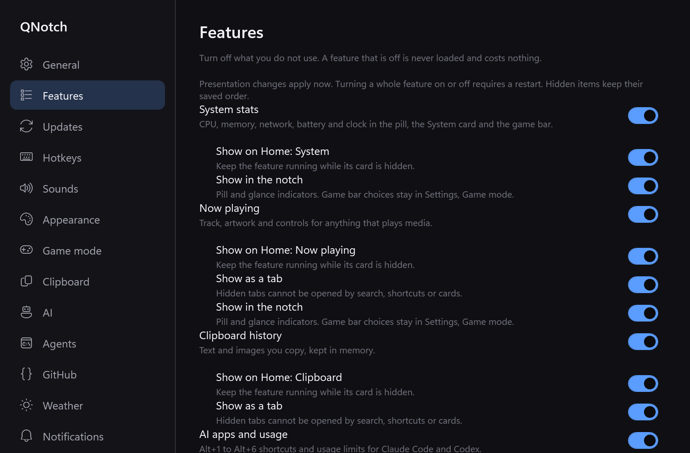
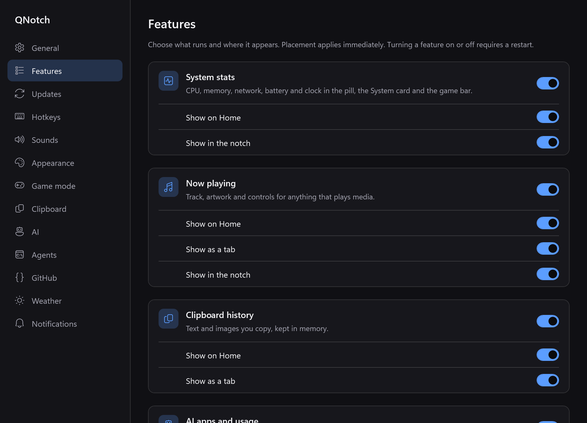
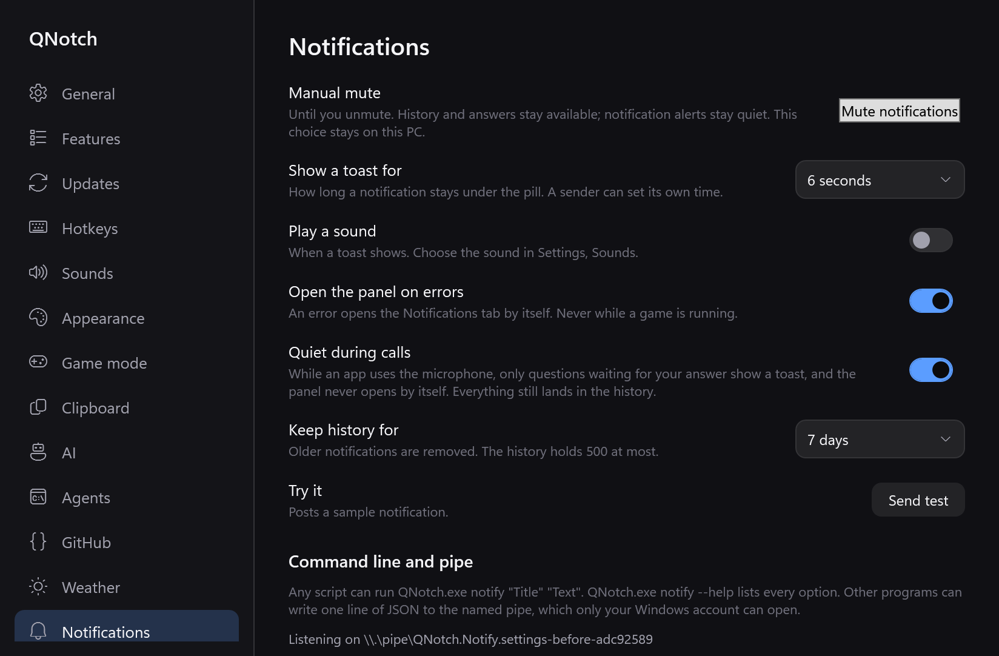
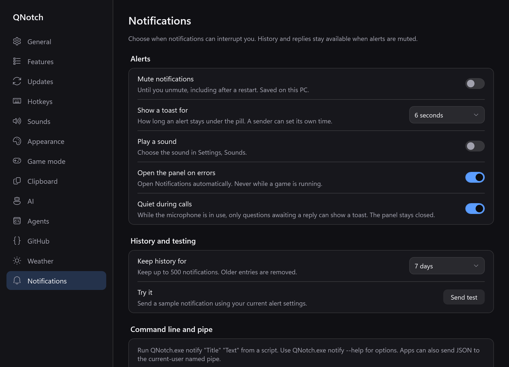

# Windows settings layout

Native WPF evidence, 2026-10-22, Windows x64. This follow-up improves the Windows UI for #78 and #77 and is stacked on the Windows Terminal PR #89. It changes no Mac UI/runtime code or portable settings fields.

The layout reference is the actual Mac implementation: `SettingsController.featuresPage` and `Controls.settingsGroup` / `settingsRow` from merged #84, plus the grouped notification settings in #83. Windows keeps its own enablement/restart, navigation and presentation behavior.

| Before | After | Why |
| --- | --- | --- |
|  |  | Separate rounded groups, feature icons, short placement rows and consistent alignment. |
|  |  | Group alert behavior, history and sender settings; replace the plain mute ToggleButton with the existing ToggleSwitch. |

The baseline is the previously published Windows Terminal build, rendered with demo data. These are app renders, not captures of personal settings. Default window sizes differ: the old 840×580 window and the new 960×720 window. Both are rendered at 2×. The new minimum is 760×520.

Additional renders:

- [Light Features](light-settings-features.png), [end](light-settings-features-end.png).
- [Light Notifications](light-settings-notifications.png), [end](light-settings-notifications-end.png).
- [Dark Features end](dark-settings-features-end.png), [Notifications end](dark-settings-notifications-end.png).
- [Muted switch](notifications-muted.png), seeded with local `Muted=true` in a read-only run.
- [Pending restart at minimum window size](features-pending-minimum.png), from an isolated live debug instance. The feature's nearby restart action disappears when the change is cancelled. This run enabled only System stats, so its sidebar does not represent the full navigation list.

## Validation

- `dotnet build src/QNotch/QNotch.csproj -c Release -warnaserror`: passed, no warnings.
- Updater 27/27, phone sharing 10/10, onboarding 25/25, Windows deterministic checks 5/5: passed.
- Full dark native `--smoke-test`: passed, [report](smoke-report.txt) ends in `done`. Includes presentation, accessible names, notification CLI/transport, timer continuity and deterministic Terminal fixtures.
- The manual-mute smoke check now toggles both Settings and panel controls through UI Automation and verifies state synchronization in both directions, toast cancellation and no replay.
- Light settings and onboarding snapshots: [report](light-snapshot-report.txt) ends in `done`. Muted state: [report](muted-snapshot-report.txt) ends in `done`.
- `node scripts/check-snapshots.mjs` passed on the complete dark smoke, light snapshot, muted snapshot and baseline output directories. This evidence folder contains a selected subset of their PNGs and outlines; it is not a complete diagnostic output directory.
- [Isolated live check](live-checks.txt): minimum window sizing, persisted feature switch, inline restart feedback and cancellation passed. The harness waits for the existing 500 ms settings debounce before checking disk.
- Inspected dark/light Features, Notifications including sender settings, muted state, the minimum-size pending state and onboarding after the shared switch change.

All runs used unique `QNOTCH_INSTANCE` values and explicit test data directories under ignored `dist/`, with `UpdateChecksChoiceMade=true` and `CheckForUpdates=false`. The live debug instance enabled only System stats. No user's instance was driven, and no real shell ran in snapshots or smoke fixtures.

Windows refused foreground acquisition during two synthetic hotkey smoke checks; they reported explicit skips while verifying panel open/close and internal Search focus. Whole-module live teardown remains intentionally skipped under the Windows restart contract. Physical hotkey foreground transfer, keyboard-only navigation through an overflowing sidebar, and a subjective layout review on another Windows display remain manual checks.

This is a settings UI change: no new providers, idle timers, animation loops or terminal work. No new idle CPU or memory result is claimed; the previously documented CPU gap in #89 remains open. No scripts, shared contracts, CI, release configuration or runtime dependencies changed.

The initial PR CI run passed Windows, repository and website validation but failed the inherited Mac Terminal descendant-cleanup test. That test sampled a descendant immediately after reaping the shell, although signal delivery to the descendant can finish later. A separate test-only follow-up waits up to two seconds for the same gone-or-zombie condition, retaining the shell's shutdown deadline and unrelated-session survival assertions. Native Mac validation runs in CI; this Windows host cannot run XCTest.
