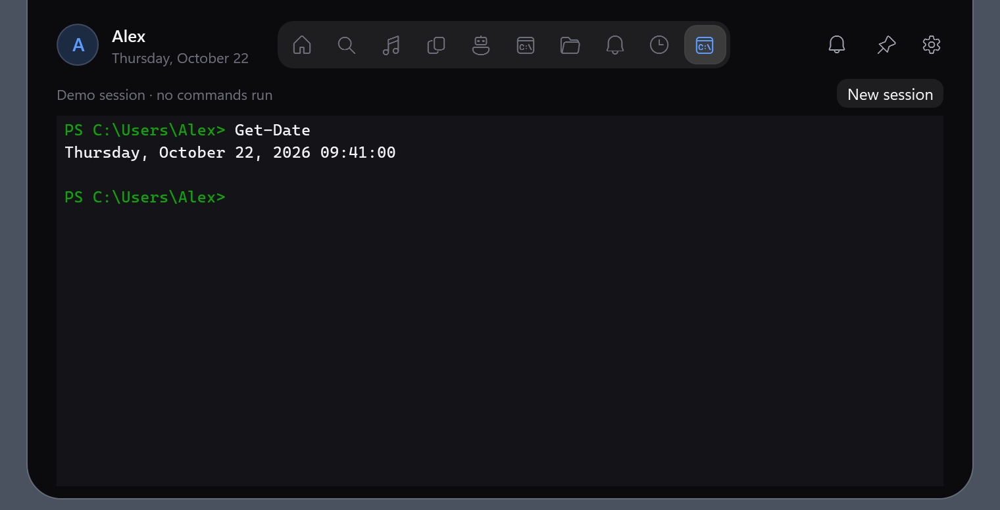
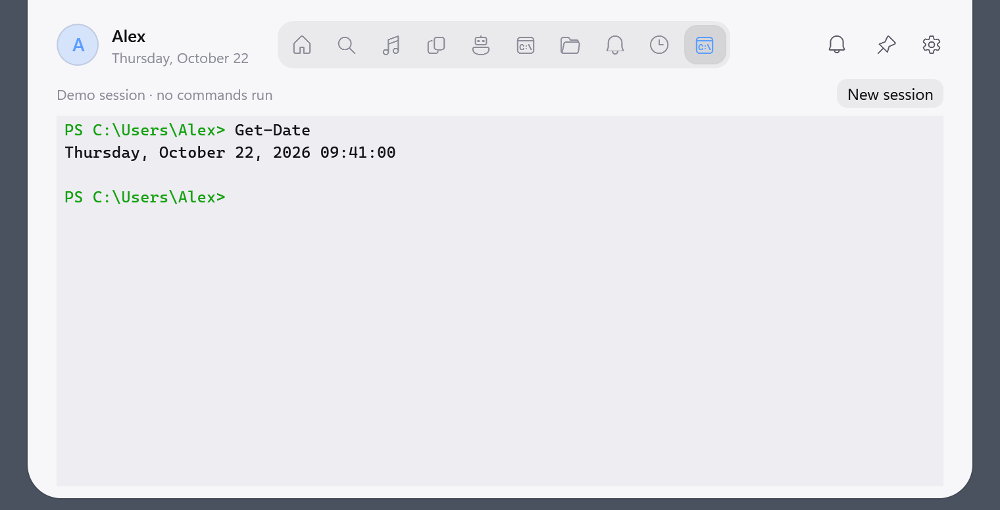
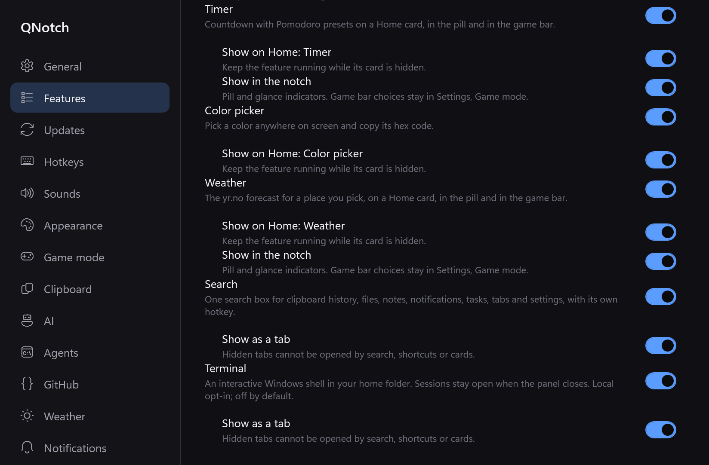
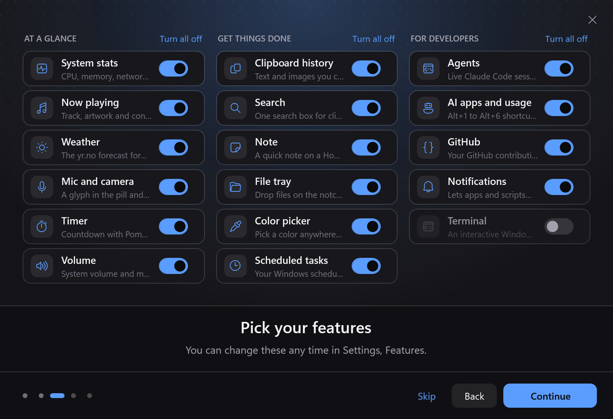

# Windows Terminal and final regression evidence

Implements the Windows portion of #75 on source commit `02799790bfda68066874a30a5df5281f885e822f`, with the idle-trim correction in `017d700018f1740ebd8017336568daf3164fcd9d`, rebased onto current main after the separately merged integration #88 brought in Windows presentation #85 and mute #86. Open and merged PRs were refreshed before the task and before PR creation; Mac #87 is a separate native implementation with the same default-off/retained-session direction. No overlapping Windows ConPTY implementation was found. No Mac source or new runtime dependency was added.

The sample screen is a fixture. No shell, command or ConPTY runs in snapshot, smoke or built-in measure mode. Features snapshots intentionally register every module; normal installs and the first-run tour default Terminal off. See [Windows Terminal](../../terminal.md) for process ownership, local opt-in/setup-code isolation, keyboard behavior, buffer limits and renderer limitations.

On Windows 11 Pro 25H2 (10.0.26200.9711), x64, Ryzen 9 5900X / 24 logical processors / 32 GiB, .NET SDK 10.0.402 and Node 25.7.0:

- Release build with `-warnaserror` and win-x64 publish passed.
- Updater 27/27, phone sharing 10/10 and onboarding 25/25 passed. The onboarding suite now checks declared default-off choices.
- Five deterministic Windows checks plus both real ConPTY groups passed. Actual PowerShell tests cover cwd, input/output, backspace, arrows/delete, native resize, Ctrl+C interrupting a running command, natural exit, repeated teardown, failed-create cleanup, killing an owned detached child and leaving an unrelated witness alive. Deterministic coverage includes bounds, streaming escapes, alternate screen, colors, cursor queries, input modes, AltGr composition and local setup exclusion.
- `Test-TerminalLifecycle.ps1` passed against an isolated published executable: default-off boot and blocked entry, Features local opt-in/restart, real UI input and accessible screen text, global-toggle close/reopen with retained process/output and restored input focus, immediate disable cleanup, disabled restart and quit cleanup. It used unique instance/data values, update checks off, and only owned PID cleanup. CI now runs this and real ConPTY checks separately from fixtures.
- [Full native smoke](smoke.txt) ends in `done`, and `node scripts/check-snapshots.mjs` passes. A separate light snapshot run also ends in `done` and passes its checker. Inspected the dark/light Terminal, Features and onboarding PNGs above. New `terminal-fixture` checks custom input accessibility, focused input after the global panel toggle, Escape ownership and shortcut capture/restoration, with zero shell creations. Extended presentation checks verify all notch hosts actually hide, including Weather's legacy preference. The active Timer retained its exact deadline and advancing countdown while hidden/shown. Muted CLI/pipe/actions/timeouts and existing checks pass.
- [Native display evidence](placement.txt): 2560×1440 at `(0,0)` / 100%, and 5120×2880 at `(2560,-731)` / 200%. Collapsed/expanded full-top attachment and ±10000 DIP nudge clamping passed on both. Game mode/corner placement passed. No Windows geometry fix was needed for #74.
- Search off/on boot, blocked entry paths, saved shortcut and welcome choice were verified in #85; no #76 failure reproduced. This change preserves its restart enablement contract.
- `npm ci`, all 42 repository checks and `git diff --check` pass. The required `build` aggregate is preserved; release endpoints, asset names, tags, ZIP contents and publish-profile isolation are unchanged.

The cross-DPI check exposed WPF logical `IsActive=true` while Win32 foreground remained the external app and the shell's keyboard lease stayed false. Hover verification now asserts the actual OS foreground and keyboard lease; it does not treat that stale logical flag as focus theft. Synthetic keyboard-open tests explicitly skip native foreground acquisition where Windows refuses it, while still verifying input focus within the window. Physical global chords, tray clicks and display reconnects remain manual. Complex Unicode shaping and advanced full-screen terminal applications retain the documented initial-renderer limits.

Shared shell changes are metadata for local default-off features, Features/tour handling, custom input focus and shortcut capture, diagnostic text/input support, compact tab spacing and `IDisposable` module cleanup. All ConPTY P/Invoke, session state, renderer and keyboard encoding live in `Modules/Terminal/`. The Timer change adds regression coverage only. No merge or release was performed by this task.

## Idle evidence and remaining CPU gap

The [pre-trim retained-shell run](performance-before-trim.json) and [Terminal-off control](performance-off-before-trim.json) both exposed working sets above 80 MiB after an early panel open/close. `OpenPanel` cancelled the initial startup working-set trim, then `ClosePanel` replaced it with heap-only compaction and a ten-minute trim. The shell now preserves the initial trim request until an idle panel close, reusing the same cancellable one-shot timer. Later closes retain their existing policy.

The [follow-up retained-shell run](performance-on.json), built from clean app source `017d700`, used a private debug instance, every other module off, a real idle PowerShell session, an off-screen owned window, 20 s warmup and two 30 s intervals. Panel state was checked outside each interval and stayed collapsed. Exact process cycles were calibrated with three 100 ms thread-cycle spins. QNotch resident memory was 6,864,896–14,487,552 bytes (6.5–13.8 MiB), under 80 MiB. [PID-filtered WPF ETW](render-on.json) recorded zero events/repaints during both intervals; startup render events confirm the provider was active. Raw ETL/XML stays local and no other process's event data is published.

CPU measured **0.198% and 0.251% of one core**, above the 0.1% target. The [post-fix Terminal-off control](performance-off.json) measured 0.311% and 0.191%, resident memory 7,090,176–14,012,416 bytes, zero [render events](render-off.json), and no owned child processes. The original full-app baseline in #85 also exceeded CPU; no CPU pass is claimed. PowerShell's separate resident set was 101,765,120 bytes and conhost's 10,133,504 bytes; those owned-child costs are not hidden inside the QNotch-only working-set number. The renderer/session are bounded and add no idle polling, but these measurements do not establish an acceptable full-app CPU baseline or a memory cap across every later interaction.

The [initial on-screen trial](performance-on-screen.json) is retained as a failed/unverified idle trial: it requested collapsed state without reconciling it and later recorded rendering. Subsequent comparison runs moved only the owned test window off screen and verified collapsed state. The pre-trim and follow-up values are reported separately rather than dropping the failed measurements.

Measured `017d700` executable SHA-256: `53F67D0B4CBA67B47B8C243BB80128169E99D9E41723C461A5182729E9D59678`. The final app code is `9d5c636`, which adds optional child-environment overrides for tests so PowerShell history/cache also stays isolated; normal launches still inherit their environment. The final executable SHA-256 is `18246873895E860C810F0803F3A220C1A6C8A1A041097F89F56BE1AEC3B0FD5D`, with build/native lifecycle checks repeated. Measurements are attributed to the measured build, not relabeled as a final CPU pass. The PR remains a draft pending the CPU target and the manual checks above.
